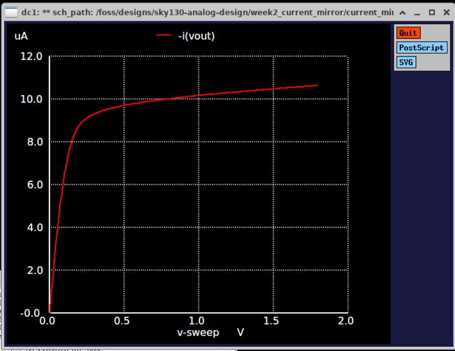

# sky130-analog-design
Analog IC design in the open-source SkyWater 130nm flow: MOSFET characterization, current mirror, op-amp, PVT/Monte Carlo analysis, and layout with DRC/LVS using Xschem, ngspice, Magic, and Netgen.

## Progress
- **Week 1: MOS Characterization** ([notes](week1_mos_characterization/notes.md)): Simulated NMOS and PMOS I-V curves. NMOS
  Vth ≈ 0.33 V, gm ≈ 441 µS at Vgs = 1.o V (W/L = 1/0.15). This showed how a longer
  channel (L=1) gives flatter saturation curves (about 5% vs. 10% current rise across Vds).

  

- **Week 2: NMOS Current Mirror** ([notes](week2_current_mirror/notes.md)): Simulated a basic NMOS current mirror (W = 2, Iref = 10 µA, VDD = 1.8 V) at L = 1 and L = 0.15. At Vout = 1.0 V, Iout/Iref is 1.017 for L = 1 and 1.24 for L = 0.15. Output resistance is about 1.70 MΩ at L = 1 vs. 115 kΩ at L = 0.15, and the L = 1 mirror needs about 0.23 V of compliance voltage.

  
