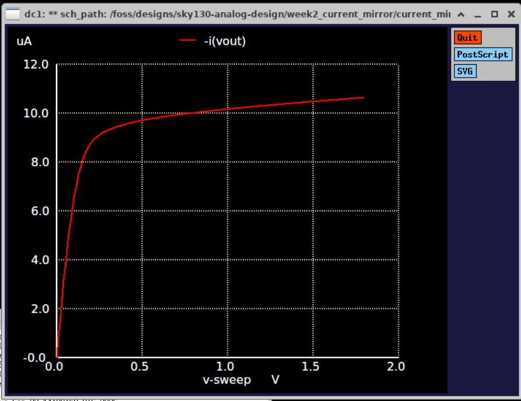
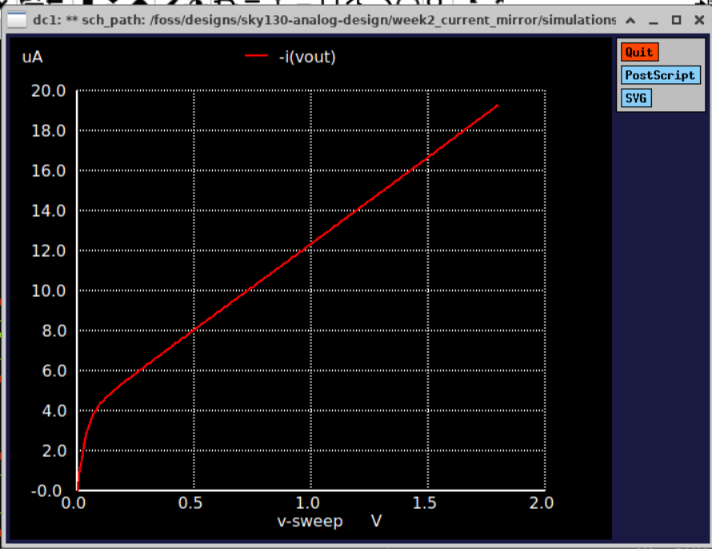

# Week 2: NMOS Current Mirror

## Circuit

- M1, M2: sky130\_fd\_pr\_\_nfet\_01v8, W = 2, L = 1

- Iref = 10 µA, VDD = 1.8 V

- Sweep: Vout 0 to 1.8 V, 10 mV step

## Results (L = 1)

- Iout at Vout = 0.5 V: -9.70626 \* 10^-6 A

- Iout at Vout = 1.0 V: -1.01668 \* 10^-5 A

- Iout at Vout = 1.8 V: -1.06368 \* 10^-5 A

- Iout/Iref at 1.0 V: 1.016675

- Compliance voltage (Iout = 9 µA): 0.225692 V

- Vout where Iout = Iref (v\_match): 0.782976 V

- Output resistance ro: 1.702091 \* 10^6 Ohms

## Results (L = 0.15)

- Iout at Vout = 0.5 V: -8.06833 \* 10^-6 A

- Iout at Vout = 1.0 V: -1.23693 \* 10^-5 A

- Iout at Vout = 1.8 V: -1.93160 \* 10^-5 A

- Iout/Iref at 1.0 V: 1.236926

- Compliance voltage: N/A (no clear knee)

- Vout where Iout = Iref (v\_match): 0.724716 V

- Output resistance ro: 1.151621 \* 10^5 Ohms

## Plots

## Observations

-                                                                                                                                                                                                                                                                                                                                                                                                                                                                                                                                                                                                                                                                                                                                                                                                                                                                                                  

